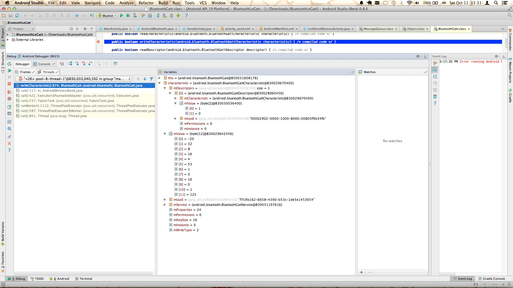

# UP24 Hacking

### Intro

Last month I received a [Jawbone UP24](https://web.archive.org/web/20150528014459/https://jawbone.com/store/buy/up24) as a birthday gift, and after a couple of weeks of _standard use_ I couldn't resist digging into its technical side to discover how this device actually works.

As far as I could tell, the UP24 has a 3-axis accelerometer, 2 notification LEDs, a vibration motor and a Bluetooth LE interface to communicate with the companion smartphone app "UP" (available for Android and iOS). Technical readers can find further info and a complete teardown of the _low-end_ version of UP24 (the older UP) [here](https://www.eevblog.com/forum/blog/eevblog-412-jawbone-up-pedometer-teardown/).

Part of the UP24's strength is its great companion app, which lets users configure alarms and notifications in response to activities or events. Two great features are the _smart alarm_, which chooses the best time to wake you up in the morning, and _idle notifications_, which remind you to stretch your legs after sitting still for too long.

The UP24 is definitely meant to be an activity band, and I think this is the only reason why the folks at Jawbone decided (at the time of writing) not to provide some extra features I'd find useful, like notifications for emails, SMS, calls, etc.

<iframe class="line-17-d line-11-m" src="//www.youtube.com/embed/fVznagkOwo0" frameborder="0" allowfullscreen></iframe>

### Beginning

I wanted to use my UP24 as a notification device for messages from some of the contacts on my Android phone: something simple, like a _vibrate on SMS_.

So, as usual, the first question is:

> "has someone already solved my problem?"

Googling around, I found [something here](https://web.archive.org/web/20150708024111/http://www.plutinosoft.com/hacking-bluetooth-le) and [here](https://forums.adafruit.com/viewtopic.php?f=8&t=51450).
Perfect! Except there was no code available, and it was the wrong OS :)

However, thanks to these posts I knew it was possible to make my UP vibrate on command, through some custom Bluetooth LE command.

### Learning

After learning the basics of Bluetooth LE ([here's](https://www.usenix.org/conference/woot13/workshop-program/presentation/ryan) one of the most interesting articles I found), I needed to find out how to use it on Android.

I found a great example and all the necessary documentation [here](https://web.archive.org/web/20170708165854/https://developer.android.com/samples/BluetoothLeGatt/index.html), and after installing Android Studio I was ready to start!

### Doing

Using the example from the Android SDK, I was able to list all the services of my UP24 in a matter of minutes. However, I still didn't have a clue which services, attributes and values I had to use to make the UP24 vibrate.

> Then I thought of debugging the process on my phone

to see what was happening behind the scenes while issuing a vibrate command. Note that there isn't any _vibrate command_ in the UP application, but I noticed that the band vibrates after a successful Bluetooth pairing, and that was exactly the reaction I wanted for my custom-notifications app.

After connecting my phone to the Android Studio debugger, I set a breakpoint in the UP process on the `BluetoothGatt.writeCharacteristic` method. This made everything _a lot_ slower on both my old phone and my laptop but, in the end, after a successful pairing, I got what I wanted :)

> -20 32 8 16 4 53 1 0 16 0 1 125.

And by the end of the day I was able to record the video at the top of this page.

    

### Epilogue

I'm still writing my custom-notifications app, but I'm not releasing any of its source code because of possible legal issues. However, any _mid-level_ programmer should be able to achieve the same results just by following the steps in this post.

### Assignment

I also ran some experiments to reverse engineer a couple of the _sniffed_ values. What happens if you change the previous value to "-20 32 8 16 4 53 1 0 **3** 0 1 125" ? :)

_-- 11/10/2014_