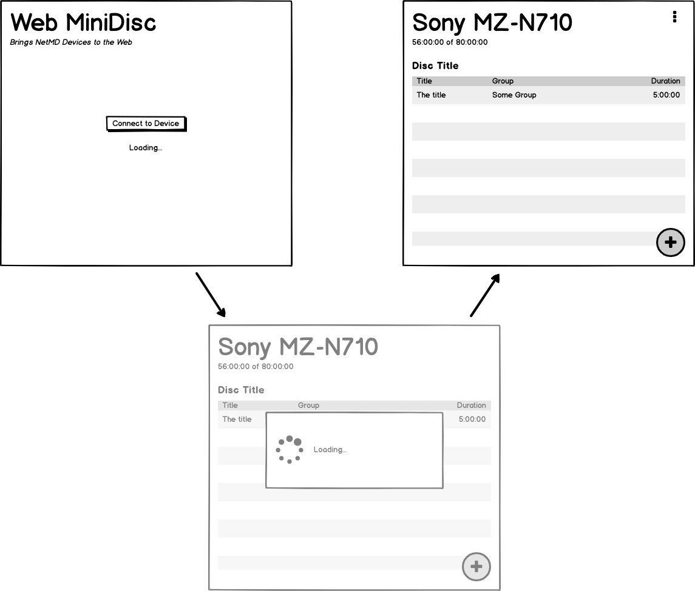

If you've never heard of the MiniDisc don't worry, you're not alone.

If you're curious, you can catch up by reading the [Wikipedia page](https://en.wikipedia.org/wiki/MiniDisc),
or the old community portal [minidisc.org](https://www.minidisc.org/), or interact with the reddit community of [/r/minidisc](https://reddit.com/r/minidisc).

If you're not, long story short, it's a dead music format released by Sony in the early '90s, and slowly killed
by the popularity of the many MP3 players that started coming out in the early 2000s.

Some of the last MiniDisc players, branded as _NetMD_ units, were equipped with a USB port that allowed for recording music onto the device using the infamous SonicStage software (Windows only, of course).
When Sony abandoned the MiniDisc, that software was left unmaintained and, nowadays, it can't run outside virtual machines or without using dangerously unsigned drivers.

Luckily the OSS community managed to completely reverse engineer the NetMD protocol and, before the death of the MiniDisc, the [linux-minidisc](https://wiki.physik.fu-berlin.de/linux-minidisc/doku.php) project was released.

A few weeks ago, just before the coronavirus lockdown here in Italy, I was lucky enough to find my old [MZ-N710](https://www.minidisc.org/part_Sony_MZ-N710.html) in my parents' basement.
Determined to make it work on my Macbook, I brought it home and successfully managed to compile and run the linux-minidisc CLI.

## Porting the MiniDisc to Web

Uploading music with the CLI took two steps:

1. Convert your music

- Use `ffmpeg` [[1]](#ffmpeg) to create a 16bit 44100Hz pcm wav file (SP quality)
- Use `atracdenc` [[2]](#atracdenc) to create a 132/66 Kbit ATRAC3 file (LP2/LP4 quality)

2. Use the CLI to send the converted music to the device

Not the most _user-friendly_ process for those who don't fancy typing commands in a terminal.

So, after pondering for a while, I realized these steps could be wrapped in a _no-install-required_
progressive web app, for a considerable step up in the ease of the process.

I would just use:

- **WebUSB**[[8]](#webusb) to replace the CLI for communicating with the NetMD device
- **emscripten**[[9]](#emscripten) to bring `ffmpeg` and `atracdenc` into the browser
- **React**[[10]](#reacjs) to create a simple UI

### 1. Writing a library

I started by porting the code from linux-minidisc to a new JS library that I've now published on npm, called `netmd-js`[[3]](#netmdjs).

This library implements the NetMD protocol and takes care of the USB communication with the device.
It will also allow other devs to write their own app, should mine not suit their needs.

It runs both in Node.js and in every browser that supports the WebUSB standard, and uses _Worker Threads_[[4]](#workerthreads) or
_Web Workers_[[5]](#webworkers) to speed up the
music encryption step required by the protocol. The encryption has been implemented on top of _CryptoJS_[[6]](#cryptojs).

### 2. Using emscripten

I was lucky enough to find a project called `ffmpeg.js`[[7]](#ffmpegjs) that already ported ffmpeg to WASM.
So, the only thing left to do was to configure it properly and recompile it, to trim down the binary size.
A full tutorial is available in the GitHub page of `ffmpeg.js`.

Then I followed a similar process to cross-compile the `atracdenc` encoder, and wrote a simple JS wrapper around it.

### 3. The Web MiniDisc Application

With all the building blocks in place, I shifted my focus to designing the app's user interface and experience.

    

> _A dead simple user experience_

Then I started off with the classic _create react app + TypeScript_ template, and added _redux_ and _material-ui_ components... a _no-frills_ setup.

## How to use a NetMD device in 2020

A couple of nights later I was ready to record the first demo of the Web MiniDisc Application.

It was exciting to see the app work seamlessly both on my Macbook and on my Android phone without an `if` needed.

<iframe class="line-17-d line-11-m" src="//www.youtube.com/embed/Frs8qhw0g9Y" frameborder="0" allowfullscreen></iframe>

### Public launch

Honestly, there aren't many places to launch a MiniDisc app in 2020 :) 
It's a pretty tiny niche.

However, I have been lurking for some time in [/r/minidisc](https://www.reddit.com/r/minidisc/) and decided to start from there.
[The feedback was great](https://www.reddit.com/r/minidisc/comments/fn4acd/web_minidisc_application/), and people even responded with a few bug reports and feature requests.

### Links

If you're a lucky owner of a NetMD device, you can try the app yourself at

[https://stefano.brilli.me/webminidisc/](https://stefano.brilli.me/webminidisc/)

Or, if you just want to browse the code, everything's available on GitHub.

[https://github.com/cybercase/webminidisc](https://github.com/cybercase/webminidisc)

### References

1. FFmpeg, [https://ffmpeg.org/](https://ffmpeg.org/)
2. atracdenc, [https://github.com/dcherednik/atracdenc](https://github.com/dcherednik/atracdenc)
3. netmd-js, [https://github.com/cybercase/netmd-js](https://github.com/cybercase/netmd-js)
4. Worker Threads, [https://nodejs.org/api/worker_threads.html](https://nodejs.org/api/worker_threads.html)
5. Web Workers, [https://developer.mozilla.org/en-US/docs/Web/API/Web_Workers_API/Using_web_workers](https://developer.mozilla.org/en-US/docs/Web/API/Web_Workers_API/Using_web_workers)
6. CryptoJS, [https://code.google.com/archive/p/crypto-js/](https://code.google.com/archive/p/crypto-js/)
7. ffmpeg.js, [https://github.com/ffmpegjs/ffmpeg.js](https://github.com/ffmpegjs/ffmpeg.js)
8. WebUSB, [https://wicg.github.io/webusb/](https://wicg.github.io/webusb/)
9. emscripten, [https://emscripten.org/](https://emscripten.org/)
10. React, [https://reactjs.org/](https://reactjs.org/)
